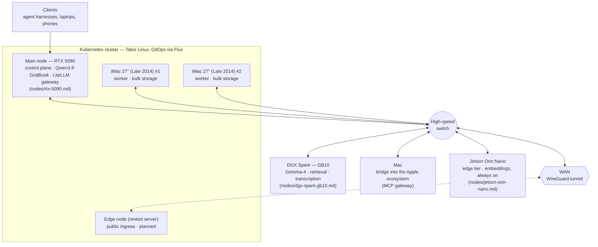

# The home lab, exposed

The topology the [node profiles](dgx-spark-gb10.md) live in. Everything at
home hangs off one high-speed switch, and one node is joining from outside
over the WAN. The role split is the interesting part.

## How the pieces relate

- **Main node (RTX 5090)** — control plane and the cluster's workhorse: fast
  interactive inference with vision, plus the LiteLLM gateway that puts both
  inference boxes behind one API ([profile](rtx-5090.md)). Also carries the
  ingress, API management and the multi-user agent gateway.
- **Two iMac workers** — see below.
- **Edge node (planned)** — see below.
- **DGX Spark (GB10)** — German prose, retrieval and transcription, and the
  research testbed ([profile](dgx-spark-gb10.md)). Deliberately *not* a
  cluster node: one box, explicit memory budgeting, no scheduler moving
  things mid-benchmark.
- **Mac** — the bridge into the Apple ecosystem: exposes Mail, Calendar,
  Notes & Co. to agents via MCP
  ([mac-mcp-gateway](https://github.com/TechPrototyper/mac-mcp-gateway)),
  so cluster-side agents can act on Apple-side data without anything Apple
  running in the cluster. It stays macOS and never becomes a Talos node.
- **Jetson Orin Nano** — the edge tier: two embedders that keep retrieval warm
  no matter what the big boxes are doing, plus a small edge LLM on standby
  ([profile](jetson-orin-nano.md)). Also the designated home of the planned
  out-of-band watcher, which must live outside the failure domain it
  watches.
- **High-speed switch** — the reason two-stage retrieval (embed on one box,
  rerank on another) is latency-free in practice.

## Two iMacs from 2014 as Kubernetes workers

Two 27" iMacs bought new in late 2014 (Core i5-4690, 32 GB RAM, 1 GbE) now
run Talos Linux as cluster workers. Twelve-year-old desktops are not what
anyone pictures in an AI lab. They are exactly right for the jobs a GPU node
shouldn't do: storage, backups, and services that need RAM and uptime but
no accelerator.

- **Fusion Drive, decoupled.** Apple's Fusion Drive is a ~121 GB SSD and a
  1 TB HDD presented as one volume by macOS. Linux sees two plain disks, and
  that is how they're used:
  - **SSD:** the Talos system disk.
  - **HDD:** a separate data volume (a Talos `UserVolume`) for Longhorn.
- **Replicated bulk storage, measured before adopting.** A Longhorn class
  with one replica on each iMac's HDD lets volumes follow pods between the
  two machines.
  - **Cost:** sequential writes drop from 149 to 103 MB/s. Synchronous
    replication hits the 1 GbE link, not the disk.
  - **Bonus:** reads get *faster* (197 MB/s), because both replicas serve.
  - **Verdict:** the abort criterion was ~50 MB/s, so replicated is the
    default and single-replica is reserved for large, non-critical data.
- **The boot quirk.** Fresh Talos v1.13 images hang on Intel Macs at boot
  ([siderolabs/talos#13579](https://github.com/siderolabs/talos/issues/13579),
  since closed upstream). It cost the first join attempt in August.
- **Taints and roles** keep GPU workloads off them and storage-heavy, latency-
  tolerant workloads on them. The services don't all need a GPU, and with
  more than one machine, a node outage is no longer a cluster outage.

## An edge node over the WAN (being wired in)

A rented server outside the house joins the cluster as an **edge node**: a
public entry point, so the home connection doesn't have to expose anything
itself. The design, written down before it's done:

- **WireGuard point-to-point** between the main node and the edge node. The
  home side initiates, so it works behind NAT with no inbound port at home,
  and a 25 s keepalive holds the NAT mapping open. UDP 51820, MTU 1420.
- **Cluster networking runs on top of it** (Cilium, VXLAN), so to Kubernetes
  the edge node is just another node, reachable through the tunnel.
- **Tainted `edge`.** Only ingress and edge components schedule there;
  nothing with private data or a GPU in its path.
- **Replaces an earlier reverse-tunnel tool** (a single-purpose TCP tunnel)
  with a plain kernel VPN that any component can use.
- **No third-party mesh service.** The tunnel is ours, end to end.

Status: the configuration exists and is inert; the switch-over is the next
infrastructure step.

---

The pattern in one sentence: **Kubernetes for everything that should be
declarative and multi-user — now across old desktops and a node outside the
house; bare Docker for the one box where memory layout is the experiment; a
bridge host for the ecosystem that won't containerize.**
