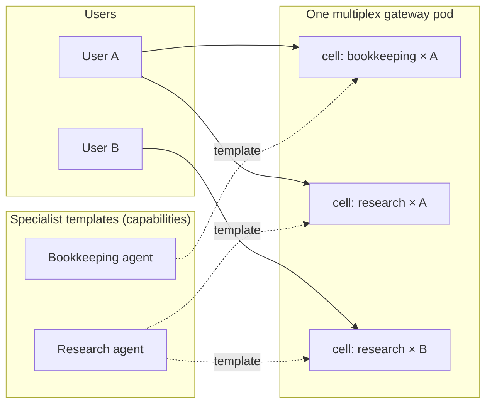

# Agent platform

Harness engineering ([previous track](../harness/README.md)) makes *one*
agent run well. This track is about serving **many**: multiple humans,
multiple specialist agents, one cluster — without the permission and
context soup that usually follows. Status: the concept is decided (ADR),
the upstream mechanics exist, the identity chain is verified end to
end, provisioning is in build. Documented now because the architecture is the interesting part.

## Cells: (specialist × user)

The core idea: an agent's context, skills, and permissions depend on two
independent dimensions — *what kind of agent is it* (a bookkeeping
specialist, a research specialist) and *who is it acting for*. The
combination is a **cell**, realized 1:1 as a Hermes **profile** (own
config, own persona, own skills, own memory, own credentials).

The rules that keep it clean:

- **Specialists are capabilities** — cataloged once (A2A agent card per
  template). **Cells are instances** — never in the catalog. *Who* is
  acting lives in the token, not in a registry.
- **One gateway process serves all cells** (Hermes' multiplex gateway:
  per-profile HTTP paths, per-profile keys, fail-closed, credential
  isolation down into MCP subprocesses). Separate pods only as a
  justified exception.
- **Identity via Keycloak** (per-cell service accounts), secrets from a
  vault via the cluster's secret operator, everything provisioned through
  GitOps — a cell is a merge request, not a snowflake.

## Cloud escalation with a data boundary

Each user's cells can carry an **escalation skill**: when the local model
isn't enough, the agent climbs a per-profile escalation ladder up to
cloud AI. Deliberate design: escalation is a *per-user provisioned
capability*, not a global default.

Planned on that path — and the part we find genuinely exciting — is a
**pseudonymization pipeline** at the boundary:

1. **Outbound**: entity names — people, companies, ledger accounts,
   project names — are replaced by stable placeholders before the prompt
   leaves the house.
2. The cloud model works on structure, not identities.
3. **Inbound**: the response is re-mapped, so results land in local
   records with the real entities restored.

The mapping table never leaves the cluster. Cloud capability, local
identities — both, not either/or.

## The front door: MCP gateway

Cells need one door, and the door turned out to be its own research question.
Thirteen MCP servers behind a four-hop chain, seven measured failure modes, a
field of fourteen gateway projects — and both commercial gateways we already
run gate MCP behind an enterprise licence. The one project that fit was missing
exactly one of the seven, and reading its source showed the mechanism was built
and simply never wired. That became
[agentgateway#3393](https://github.com/agentgateway/agentgateway/pull/3393).

Full account, with the measurements and the discards:
[**MCP gateway: why nothing fit, and what we shipped**](mcp-gateway.md).

## Where this stands

Honest ledger, as of 2026-09-10. Profiles and the multiplex gateway are
upstream Hermes features (since v2026.8.x). The cell architecture is
decided (ADR). **The identity chain is built and verified end to end**
since 2026-08-20, with a first cell: Keycloak issues a JWT carrying a
per-user claim; the API gateway validates it against Keycloak's JWKS,
swaps the bearer for the cell's own key from a dictionary keyed by that
claim, and rewrites the path to the cell's profile at the multiplex
gateway — fail-closed at every hop (no claim → no route; unprovisioned
cell → 404; never the default profile). The cluster still runs the default
profile for existing consumers; cells arrive additively.

Still open, in order: the provisioner that turns the five manual steps of
a new cell into one merge request (with the vault/secret-operator wiring
for profile secrets); the grants-to-Keycloak sync; retiring the keyless
plan on the MCP side (precondition for further human users — see
[the MCP gateway note](mcp-gateway.md)); a declarative realm. The
pseudonymization pipeline follows those. The serving side the platform
sits on is in [`deploy/`](../deploy/). Findings will show up in the
[main table](../README.md#findings-so-far) as they become measurable.
